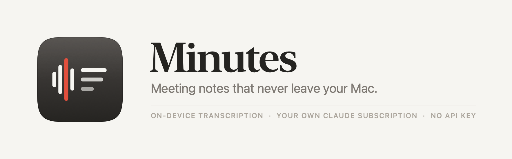

<div align="center">

<picture>
  <source media="(prefers-color-scheme: dark)" srcset="docs/banner-dark.png">
  
</picture>

<p>
  <a href="LICENSE"></a>
  <a href="https://github.com/zachwilke/minutes/releases/latest"></a>
  <a href="https://github.com/zachwilke/minutes/actions/workflows/ci.yml"></a>
  
</p>

</div>

---

**Minutes records both sides of a meeting, transcribes it on your own machine,
and writes you structured notes when the meeting ends.**

No bot joins the call. No audio is uploaded. There is no account, no API key and
no per-token bill — the notes are written through the Claude subscription you
already pay for, using the `claude` CLI on your Mac.

It is in the spirit of Granola: you type your own rough notes while the meeting
runs, and when it ends those notes are expanded into real ones using the
transcript as evidence. Your notes set the priorities; the transcript fills them
in.

## Why this exists

Hosted notetakers solve the problem by sending your meetings to someone else's
server. That is a reasonable trade for many people and an impossible one for
anyone discussing client systems, patient details, salaries or unreleased work.

Minutes makes the opposite trade. Everything that could expose a meeting —
the audio, the transcript, the speaker attribution, the search index — stays on
the machine that recorded it.

|  | Hosted notetakers | **Minutes** |
|---|---|---|
| Joins your call | A visible bot participant | Nothing joins |
| Audio | Uploaded and retained | Never leaves the Mac |
| Transcription | On their servers | On your Mac, with Whisper |
| What reaches a model | The whole meeting | The notes request, through your own subscription |
| Cost | Per seat, per month | Your existing Claude plan |
| Your library | Their database | Plain files you can read, back up or delete |

## How it works

| Stage | What does it | Where |
|---|---|---|
| System audio | Core Audio process tap — everyone on the call | Your Mac |
| Microphone | `AVAudioEngine` — you, and in-person meetings | Your Mac |
| Live text | Apple's on-device `SpeechTranscriber` | Your Mac |
| Final transcript | `whisper-cli` with `ggml-large-v3-turbo` | Your Mac |
| Speaker labels | Mic-vs-system loudness, no diarization model | Your Mac |
| Notes and Ask | `claude -p`, on your own subscription | Claude |

Audio arrives from two independent hardware clocks, so buffers are placed on a
shared timeline by host timestamp and gaps filled with real silence — otherwise
the far side drifts earlier than your microphone over a long meeting. Because
the app knows how loud each source was at every instant, it labels each segment
**You** or **Them** without a diarization model, and says **Speaker** rather
than guessing when the two overlap.

## What it does

**Records the right meetings, on its own.** A scheduled call starts recording
itself; an impromptu Teams, Zoom or Meet call asks first. Google Meet, and Teams
and Zoom on the web, are recognised from the browser tab. Brief false starts are
thrown away.

**Takes your notes seriously.** Type while the meeting runs. The prompt treats
what you wrote as authoritative on priorities and on the spelling of names and
product terms, then expands it from the transcript. Your notes are never
replaced — a switch shows exactly what you typed.

**Names meetings by itself**, from the calendar event, the call window title, or
— for an impromptu call — a few words written from the notes. A name you typed
is never overwritten.

**Knows who was speaking.** Claude is told your name, who was invited, and that
a quiet voice from the call is often mislabelled as you, so it attributes lines
by what is said rather than by label alone.

**Six note styles** — general, client call, discovery, troubleshooting,
one-on-one, standup — pickable per meeting, with your own styles alongside them.
A style chosen for a recurring event is remembered for the series.

**Answers questions across every meeting you have recorded.** "What did I commit
to last week?" "When did we last discuss the migration?" Ask searches passages
rather than stuffing whole transcripts into context.

**Reaches Claude Desktop and Claude Code** through a local, read-only MCP
server, so you can ask about your meetings from wherever you already work.

## Install

Download the DMG from the [releases page](https://github.com/zachwilke/minutes/releases/latest)
and drag Minutes to Applications. Releases are signed and notarized by Apple, so
they open normally.

Or build it yourself:

```bash
git clone https://github.com/zachwilke/minutes.git && cd minutes && ./macos/Scripts/install.sh
```

That installs whisper-cpp, downloads the speech model (a 5-bit quantized one on
a Mac with 8 GB or less), reports whether the `claude` CLI is signed in, and
leaves the app in `/Applications`.

**You need** macOS 27 or later on Apple silicon, and Claude Code signed in for
notes and Ask. Recording and transcription work without it. Building from source
also needs full Xcode — SwiftUI's property wrappers are macros on macOS 26+ and
the plugin that expands them does not ship with the Command Line Tools.

On first launch macOS asks for **Microphone** and **Audio Recording**. Until
Audio Recording is granted the tap returns pure silence, which looks exactly
like a working recording with nothing in it.

## Ask from Claude Desktop or Claude Code

**Settings › Claude** connects the library to both. Or by hand:

```bash
claude mcp add --scope user minutes -- /Applications/Minutes.app/Contents/MacOS/Minutes --mcp
```

Three read-only tools: `search_meetings` returns matching passages with their
meeting, date, timecode and speaker; `list_meetings` browses by date, person or
topic; `get_meeting` returns one meeting in full. The server never writes to the
library and opens no network connections — each Claude app starts it on your Mac
when it needs it.

## Privacy

Your library is plain files under `~/Library/Application Support/Minutes/`, one
directory per meeting. Deleting a folder deletes the meeting. There is no
database, no account, no telemetry and no server.

Exactly two things reach Claude, through your own `claude` sign-in and under
your own subscription's terms:

- **Writing a meeting's notes**, once, when it ends. The request carries your
  notes, the transcript, the invitees and your name.
- **A question you ask**, with the passages needed to answer it.

Recording, transcription, speaker labels, search and the library itself never
leave the machine. The full accounting is in
[What reaches Claude](macos/README.md#what-reaches-claude).

> [!IMPORTANT]
> **Recording other people carries legal and ethical weight**, and the rules
> differ by jurisdiction — some require every participant's consent. Minutes
> keeps recording visible, with a menu bar indicator and a stop control always
> in reach, but telling the people you meet and complying with the law where you
> are is your responsibility.

## Repository

| Directory | What it is |
|---|---|
| [`macos/`](macos/) | The shipping app — SwiftUI, macOS 27+, Apple silicon. Its [README](macos/README.md) is the deep reference: architecture, permissions, code signing, troubleshooting. |
| [`windows/`](windows/) | The port in progress: audio, pipeline and prompts, no app yet. See [`PLAN.md`](windows/PLAN.md). |
| [`shared/`](shared/) | What both must honour — the [storage format](shared/spec/meeting-format.md), the [palette](shared/design/palette.md), and the [prompts](shared/prompts/README.md). |

### Development

| Task | Command |
|---|---|
| Build the macOS app | `swift build --package-path macos` |
| Test the macOS app | `swift test --package-path macos` |
| Test the shared core | `dotnet test windows/tests/Minutes.Core.Tests/Minutes.Core.Tests.csproj` |
| Regenerate prompt constants | `macos/Scripts/generate-prompts.py` and `windows/Scripts/generate-prompts.py` |
| Regenerate the prompt baseline | `macos/.build/release/Minutes --dump-prompts > shared/prompts/baseline.txt` |
| Rebuild the README artwork | `swift macos/Scripts/MakeBanner.swift docs` |

Every paragraph the model reads lives in [`shared/prompts/`](shared/prompts/) as
JSON and is generated into both platforms' sources, so they cannot quietly drift
apart. `shared/prompts/baseline.txt` is the parity contract: the full rendered
output of every prompt against fixed fixtures, which both must produce byte for
byte.

## Contributing

Issues and pull requests are welcome — see [CONTRIBUTING.md](CONTRIBUTING.md)
for the contracts that are easy to break without noticing.

## License

[MIT](LICENSE).
